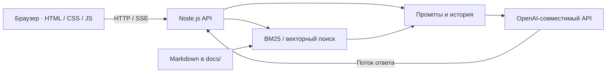

<div align="center">

# LLM Web Assistant

**AI-ассистент для повседневных задач веб-разработчика**

Генерация интерфейсов · Ревью кода · Объяснение · Тесты · Поиск по документации


[](https://github.com/pinkpank26/LLM-web-assistant/actions/workflows/ci.yml)

[Быстрый старт](#быстрый-старт) · [Возможности](#возможности) · [Архитектура](#архитектура) · [API](#api)

</div>

Веб-приложение на чистом JavaScript и встроенных модулях Node.js: помогает создавать
компоненты, разбирать код и получать ответы по собственной документации.
Работает с OpenAI-совместимыми API и локальными моделями; демо-режим позволяет
изучить интерфейс без API-ключа и установки модели.

Проект создан в рамках изучения применения больших языковых моделей в веб-разработке.

## Инженерные решения

- **Без внешних зависимостей:** HTTP-сервер, маршрутизация, работа с файлами и тесты реализованы средствами Node.js.
- **Потоковые ответы:** SSE, отмена генерации через AbortController и тайм-аут простоя для медленных моделей.
- **Два способа поиска:** BM25 без дополнительной модели или векторный поиск с эмбеддингами.
- **Изоляция предпросмотра:** сгенерированный HTML запускается в sandbox iframe.
- **Проверка API:** валидация ввода, ограничение размера запроса, очистка истории и лимит запросов.
- **Проверка без платного API:** интеграционные тесты используют локальный поддельный сервер модели.

## Быстрый старт

Требуется Node.js 18 или новее. Установка npm-пакетов не нужна.

```bash
git clone https://github.com/pinkpank26/LLM-web-assistant.git
cd LLM-web-assistant
cp .env.example .env
```

Для первого знакомства установите `LLM_MOCK=1` в `.env`, затем:

```bash
npm start
```

Откройте **http://localhost:3000**. Например, выберите генерацию компонента
и отправьте запрос: «Карточка товара с ценой и кнопкой в корзину».
Демо-режим возвращает подготовленные ответы; для генерации по произвольному
запросу подключите модель в `.env`.

> `.env` содержит локальную конфигурацию и исключён из Git. Для публикации настроек используется `.env.example`.

## Архитектура



Ключ API хранится на сервере. История чатов и выбранная тема сохраняются
в localStorage браузера. Папка `docs/` содержит пример документации магазина
для демонстрации RAG; её можно заменить своими Markdown-файлами.

## Возможности

Пять режимов работы:
- **Генерация компонента** — HTML/CSS по текстовому описанию с безопасным предпросмотром (iframe sandbox);
- **Ревью кода** — ошибки, безопасность, производительность, стиль, исправленный код;
- **Объяснение кода** — разбор для начинающего разработчика;
- **Генерация тестов** — модульные тесты на node:test;
- **Вопрос по документации (RAG)** — ответ по Markdown-документации проекта из папки `docs/` со ссылками на фрагменты.

Дополнительно:
- **история диалога** — модель помнит последние 10 сообщений, поэтому запрос можно уточнять;
- **история чатов** — завершённые диалоги сохраняются в браузере (localStorage, до 30 последних): их можно открыть заново вместе с режимом и предпросмотром, удалить по одному или очистить целиком;
- **светлая и тёмная тема** — переключатель в заголовке, выбор запоминается; при первом открытии берётся системная настройка;
- **предпросмотр компонента** — сгенерированный элемент центрируется в окне, цвет фона задаётся палитрой (удобно проверять светлые и тёмные компоненты);
- **потоковый вывод** — ответ появляется по мере генерации (Server-Sent Events), кнопка «Остановить» прерывает генерацию;
- статистика: время ответа и количество токенов.

Зависимостей нет — нужен только Node.js 18+.

## Подключение и настройка

```bash
cp .env.example .env      # затем указать адрес API, ключ и модель
npm start                 # http://localhost:3000
```

Без модели (демо-режим): в `.env` поставить `LLM_MOCK=1`.

### Скорость ответа и тайм-ауты
Локальная модель на процессоре генерирует несколько токенов в секунду, поэтому
время ответа определяется его длиной. Настройки в `.env`:

| Переменная | Назначение |
|---|---|
| `LLM_MAX_TOKENS` | предел длины ответа (по умолчанию 1200; `0` — без предела) |
| `LLM_TIMEOUT_MS` | ожидание данных от модели (по умолчанию 300000) |

`LLM_TIMEOUT_MS` считается как простой: при потоковой передаче таймер взводится
заново на каждом полученном фрагменте, поэтому длинный ответ не обрывается
посередине. Для непотокового `POST /api/assist` это предел на весь ответ целиком.

### Подключение модели
| Провайдер | LLM_BASE_URL | LLM_API_KEY |
|---|---|---|
| Ollama (локально) | http://127.0.0.1:11434/v1 | пусто |
| LM Studio (локально) | http://127.0.0.1:1234/v1 | пусто |
| OpenAI | https://api.openai.com/v1 | ваш ключ |
| Любой OpenAI-совместимый API | адрес провайдера | ключ |

Для локального сервера в `LLM_BASE_URL` указывайте `127.0.0.1`, а не `localhost`:
Ollama слушает только IPv4, а Node с версии 18 резолвит `localhost` в IPv6-адрес
`::1`, из-за чего запрос завершается ошибкой `fetch failed`.

Ollama: установить с ollama.com, затем
```bash
ollama pull qwen2.5-coder:7b       # модель для генерации
ollama pull nomic-embed-text       # (необязательно) эмбеддинги для RAG
```
и в `.env` указать `LLM_EMBED_MODEL=nomic-embed-text`. Без модели эмбеддингов режим RAG использует лексический поиск BM25.

### Своя документация для RAG
Положите Markdown-файлы (`*.md`) в папку `docs/` (или укажите другую в `DOCS_DIR`) и перезапустите сервер. Документы делятся на фрагменты по заголовкам `#`, `##`, `###`.

## API

| Маршрут | Назначение |
|---|---|
| `GET /api/modes` | список режимов, имя модели, число фрагментов документации |
| `POST /api/assist` | ответ целиком: `{ mode, input, history? }` → JSON |
| `POST /api/assist/stream` | ответ потоком SSE: события `meta`, `delta`, `done`, `error` |

## Тесты

```bash
npm test
```
22 теста: модульные (утилиты, промпты, RAG, тайм-аут клиента модели) и сквозные (API с поддельным OpenAI-совместимым сервером, включая потоковую передачу и эмбеддинги).

## Структура
```
src/server.js      HTTP-сервер, маршруты API, SSE, раздача статики
src/llmClient.js   клиент OpenAI-совместимого API: chat, chatStream, embed
src/prompts.js     системные промпты для режимов
src/rag.js         разбиение документации, BM25, векторный поиск
src/utils.js       валидация, история, разбор SSE, rate limit, оценка токенов
public/            клиентская часть (HTML, CSS, JS)
docs/              документация проекта для режима RAG (пример)
test/              тесты
```


## Границы проекта

Приложение рассчитано на локальный запуск и демонстрацию. Перед размещением
в открытом интернете потребуются аутентификация, HTTPS и ограничения расходов
на API. Сгенерированный код следует проверять перед использованием в своих проектах.

## Автор

[ pinkpank26 ](https://github.com/pinkpank26)

## Лицензия

[MIT](LICENSE)
